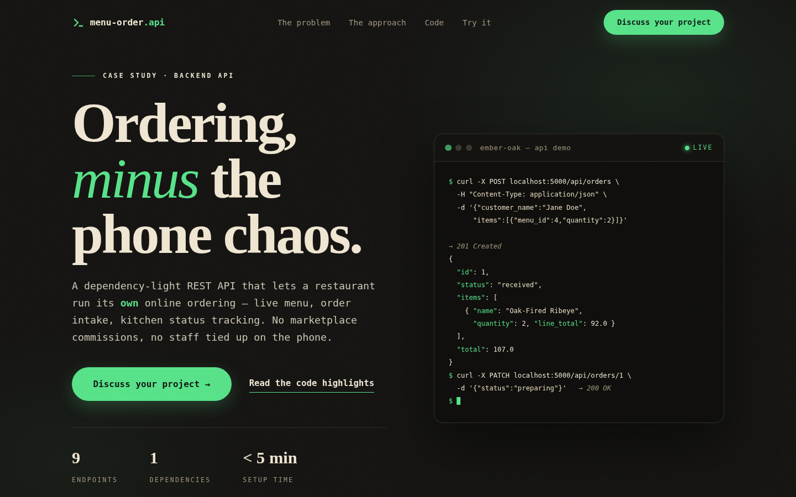

> **Live demo:** [https://savorapi-menu-order-api.vercel.app](https://savorapi-menu-order-api.vercel.app)



---

# Ember & Oak Kitchen — Menu & Order Management API

**Your restaurant's own online ordering engine — no commissions, no phone chaos.**

> **Visual case study:** open [`showcase.html`](showcase.html) for the full story — the business
> problem, the API design, real code highlights, and a live request/response walkthrough.

Most takeout orders still arrive the hard way: a host on the phone, scribbling on a pad while
the dining room waits. The alternative — a delivery marketplace — takes 15–30% of every sale and
keeps the customer relationship for itself. This API is the backend for a restaurant's *own*
ordering channel: the website or app shows the live menu and sends orders straight to the kitchen,
so the owner keeps full control and every dollar of the sale.

## What you get

- **Menu management (CRUD):** list, create, replace, and delete dishes with name, price,
  category, description, and an availability flag — including a "sold out" toggle for the kitchen
- **Order intake:** create orders from menu items; the server resolves each dish, checks
  availability, and computes line-item totals and the order total automatically
- **Kitchen status tracking:** orders move through `received → preparing → ready → completed`
  (plus `cancelled`), with a filter to pull only what's firing right now (`?status=preparing`)
- **Validation everywhere:** every write is validated with clear messages and proper HTTP status
  codes (`201` created, `204` deleted, `400` bad input, `404` missing record). All errors return
  JSON — never an HTML error page — so a front-end can display them directly
- **Self-documenting:** `/api/docs` returns a machine-readable endpoint list; the reference below
  has curl examples for every flow
- **Demo-ready:** ships with 12 realistic seeded menu items across starters, mains, desserts,
  and drinks, and runs on a single dependency

## Tech stack

- **Python 3 + Flask** — the only dependency ([`requirements.txt`](requirements.txt))
- JSON data model; in-memory storage for the demo, swappable for SQLite or Postgres in production
  (the API contract doesn't change)

## Run it

```bash
cd 02-menu-order-api
pip install -r requirements.txt
python app.py
```

The API starts at `http://127.0.0.1:5000`. Visit `/api/docs` for the endpoint list.

## Try it: from menu to kitchen in two calls

**1. Place an order** — `POST /api/orders`

```bash
curl -X POST http://127.0.0.1:5000/api/orders \
  -H "Content-Type: application/json" \
  -d '{"customer_name": "Jane Doe", "items": [{"menu_id": 4, "quantity": 2}, {"menu_id": 11}]}'
```

→ `201 Created` — note the prices are resolved *server-side*; the client only sends menu ids:

```json
{
  "id": 1,
  "status": "received",
  "customer_name": "Jane Doe",
  "items": [
    {"menu_id": 4, "name": "Oak-Fired Ribeye", "unit_price": 46.0, "quantity": 2, "line_total": 92.0},
    {"menu_id": 11, "name": "Smoked Old Fashioned", "unit_price": 15.0, "quantity": 1, "line_total": 15.0}
  ],
  "total": 107.0
}
```

**2. Advance it on the kitchen display** — `PATCH /api/orders/1`

```bash
curl -X PATCH http://127.0.0.1:5000/api/orders/1 \
  -H "Content-Type: application/json" \
  -d '{"status": "preparing"}'
```

→ `200 OK` — the order comes back with `"status": "preparing"`.

## API reference

Base URL: `http://127.0.0.1:5000`

### Menu endpoints

| Method | Path | What it does |
|---|---|---|
| GET | `/api/menu` | List all dishes (`?category=starter\|main\|dessert\|drink` to filter) |
| POST | `/api/menu` | Add a dish (name, price, category required; description, available optional) |
| GET | `/api/menu/<id>` | Get one dish |
| PUT | `/api/menu/<id>` | Replace a dish (full payload required) |
| DELETE | `/api/menu/<id>` | Remove a dish (returns `204`) |

### Order endpoints

| Method | Path | What it does |
|---|---|---|
| GET | `/api/orders` | List orders (`?status=received\|preparing\|ready\|completed\|cancelled` to filter) |
| POST | `/api/orders` | Create an order: `customer_name` + `items: [{menu_id, quantity?}]` |
| GET | `/api/orders/<id>` | Get one order with line items |
| PATCH | `/api/orders/<id>` | Update status: `{status: received\|preparing\|ready\|completed\|cancelled}` |

### More examples

**Filter the menu by category**

```bash
curl "http://127.0.0.1:5000/api/menu?category=main"
```

**Add a dish** — `POST /api/menu`

```bash
curl -X POST http://127.0.0.1:5000/api/menu \
  -H "Content-Type: application/json" \
  -d '{"name": "Heirloom Tomato Salad", "description": "Basil, smoked mozzarella, balsamic", "price": 15.00, "category": "starter"}'
```
→ `201 Created`

**Validation errors are plain English** — a bad price returns `400`:

```bash
curl -X POST http://127.0.0.1:5000/api/menu \
  -H "Content-Type: application/json" \
  -d '{"name": "Soup", "price": -5, "category": "starter"}'
```
```json
{"error": "'price' must be a positive number."}
```

Ordering a sold-out dish names the dish (`400`); requesting an unknown id returns `404`, e.g.
`{"error": "No order with id 99."}`.

## Notes

- Storage is in-memory: restarting the server resets the menu to the seed data and clears orders.
  For a production client this is backed by a real database — the API contract stays identical.
- One dependency, five-minute setup, clear enough to hand to any front-end developer.
